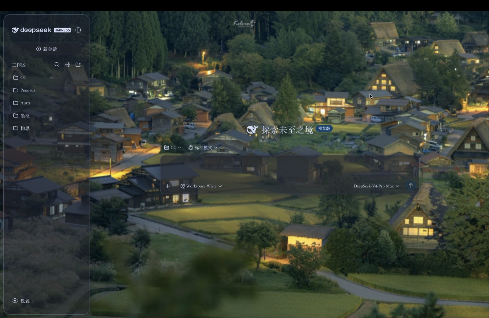
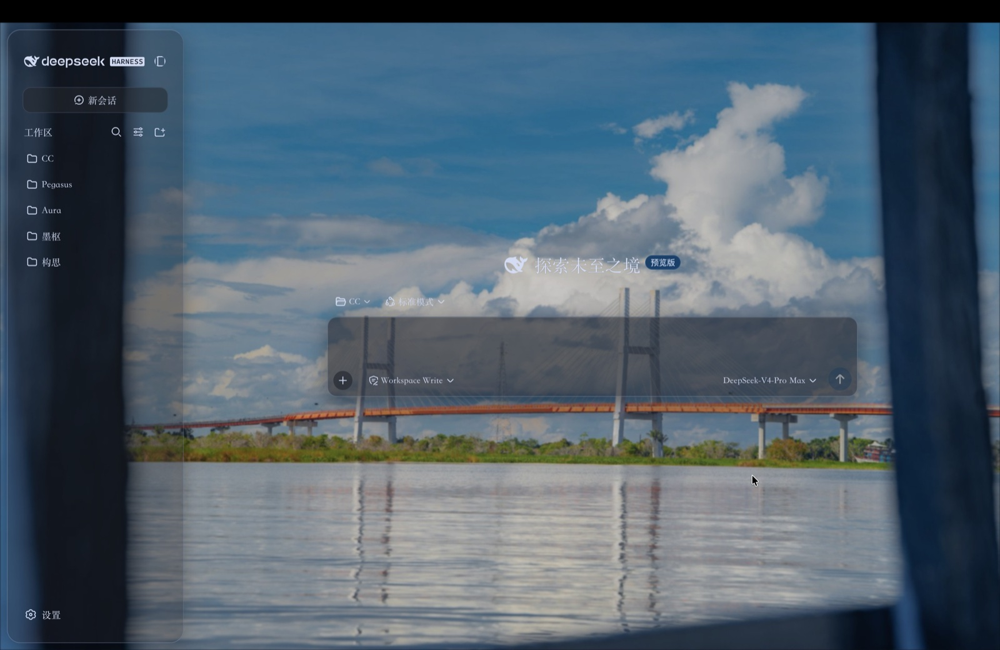
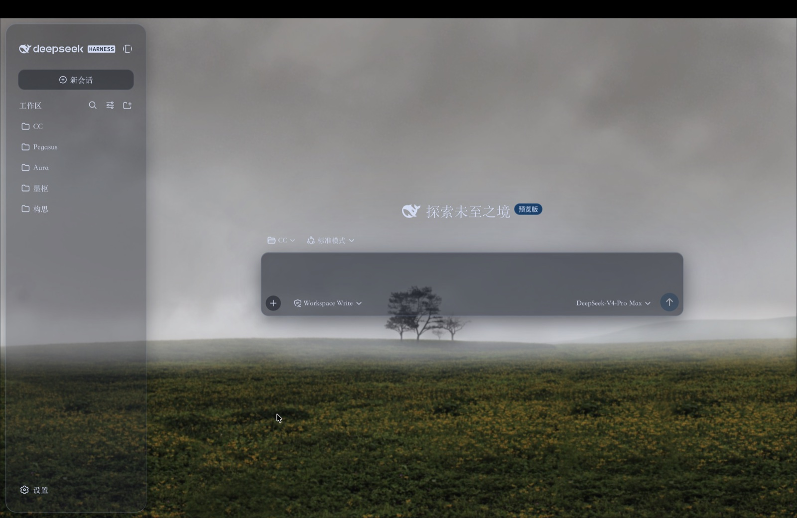

# Prism · 棱镜 — DSH Glassmorphism Theme Plugin

Prism is a glassmorphism studio for the [DeepSeek Harness](https://github.com/deepseek-ai/deepseek-harness) Web GUI. Version 2 is adapted to the DSH `0.2.2-rc.1` settings and theme APIs and ships prebuilt in `lib/`; installing the plugin does not require a build step.

## Install

Requires DeepSeek Harness `0.2.2-rc.1` or later in the `0.2.x` series.

### Desktop app

Open **Settings → Plugins → Add plugin** and enter:

```text
github:mantonlove/dsh-prism-plugin
```

For local development, use `link:/absolute/path/to/dsh-prism-plugin` instead. Linked builds can be hot-applied; refresh the Web GUI if necessary.

### Web profile CLI

```sh
dsh plugin --profile web add github:mantonlove/dsh-prism-plugin
```

Restart `dsh web` and refresh the page. Open **设置 → 通用设置 → 外观 → Prism** to use the theme studio. The master switch is built into the Prism panel.

Uninstall:

```sh
dsh plugin --profile web remove dsh-client-ui-prism
```

## What’s new in v2

- **Six visual presets:** Night, Aurora, Crystal, Dune, Rose, and Forest apply a complete, coordinated appearance recipe.
- **Portable custom themes:** save up to 24 named looks, apply or delete them, and exchange versioned JSON theme files. Import validates every value before applying it; duplicate names receive numeric suffixes instead of overwriting an existing look.
- **Task-oriented studio:** Themes, Glass, Backdrop, and Type tabs replace the old accordion and the retired `settings.plugin.item` master card.
- **Clearer controls:** accessible switches and buttons, selected/focus/disabled states, keyboard-operated sliders, double-click slider reset, and section-level zone reset.
- **Live miniature preview:** inspect the active palette and material before changing the main interface.

## Theme features

- Clear, frosted, and velvet materials; blur and global frost; six independent zone opacities for the base, sidebar, cards, inputs, overlays, and bubbles.
- Hex and color-picker controls for the accent, backdrop, and light/dark text colors.
- Spring-damped adjustments, font scale and family, animated aurora, and separate light/dark photo or GIF wallpaper playlists with fixed/loop playback and manage mode.
- A master switch that restores the stock interface, persistent `localStorage` settings, cross-tab synchronization, and reduced-motion support.
- Theme exports contain appearance settings only. Wallpaper images, wallpaper playlists, and the master-switch state are never included.

## Screenshots

Examples of the glass theme applied to the workspace, welcome surface, and composer:

| Effect 1 | Effect 2 | Effect 3 |
|---|---|---|
|  |  |  |

## Development

Requires Node.js 22+ and pnpm 11.

```sh
pnpm install
pnpm typecheck
pnpm test
pnpm bundle
```

`pnpm bundle` builds the host modules, browser bundle, CSS modules, and declarations into `lib/`. The DSH client packages and React remain external and are supplied by the host Web GUI. Prebuilt release files are committed so source installs work without developer tooling.

[简体中文](README.zh.md) · [License](LICENSE)
