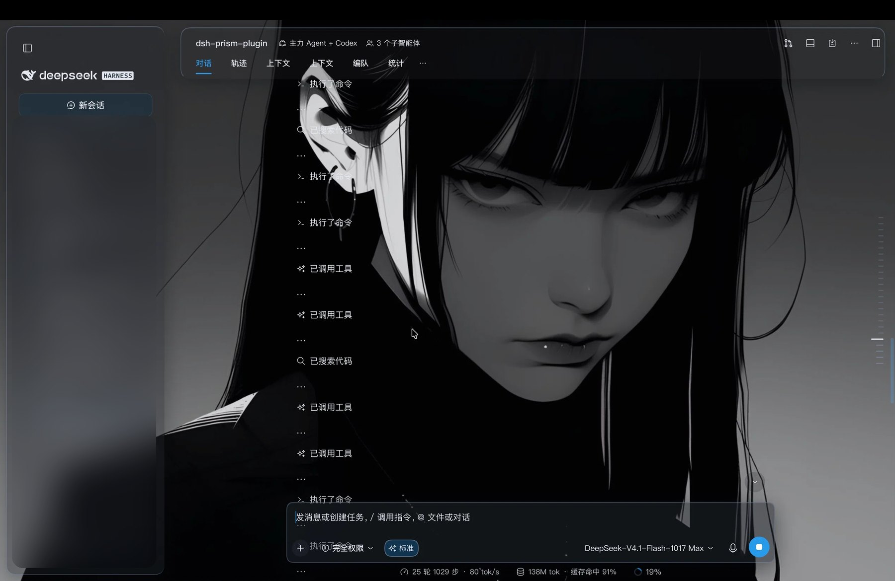
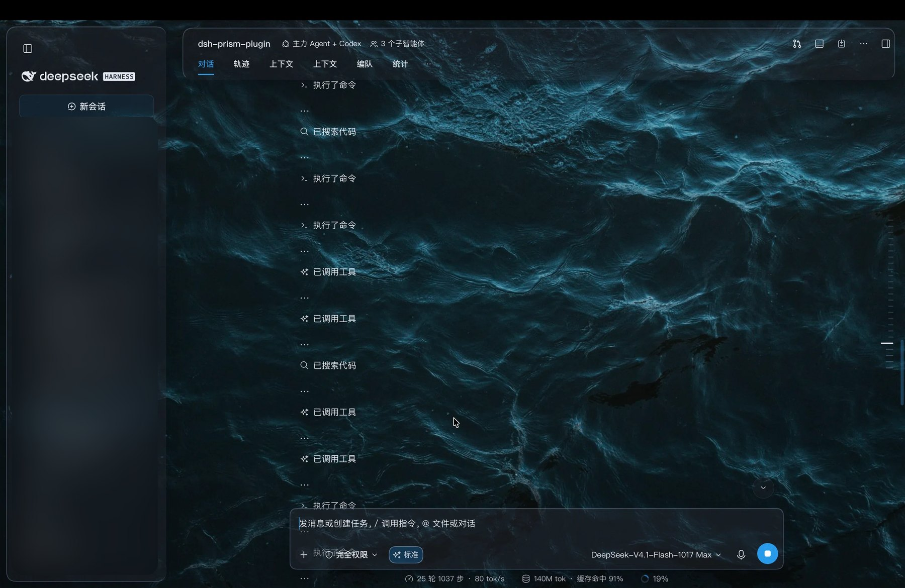
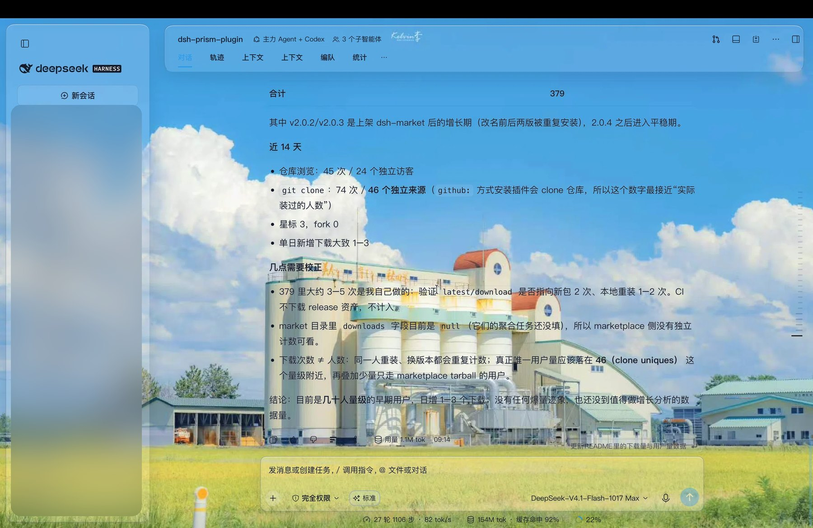
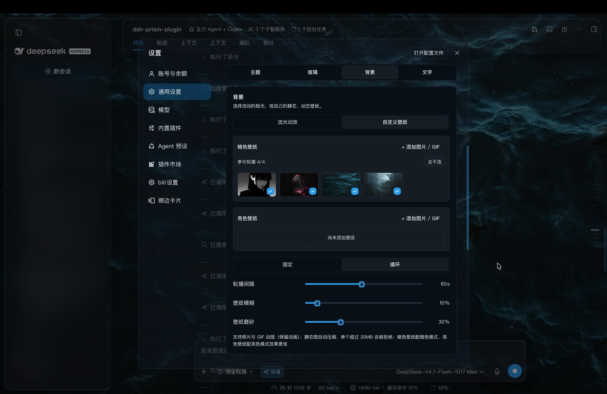
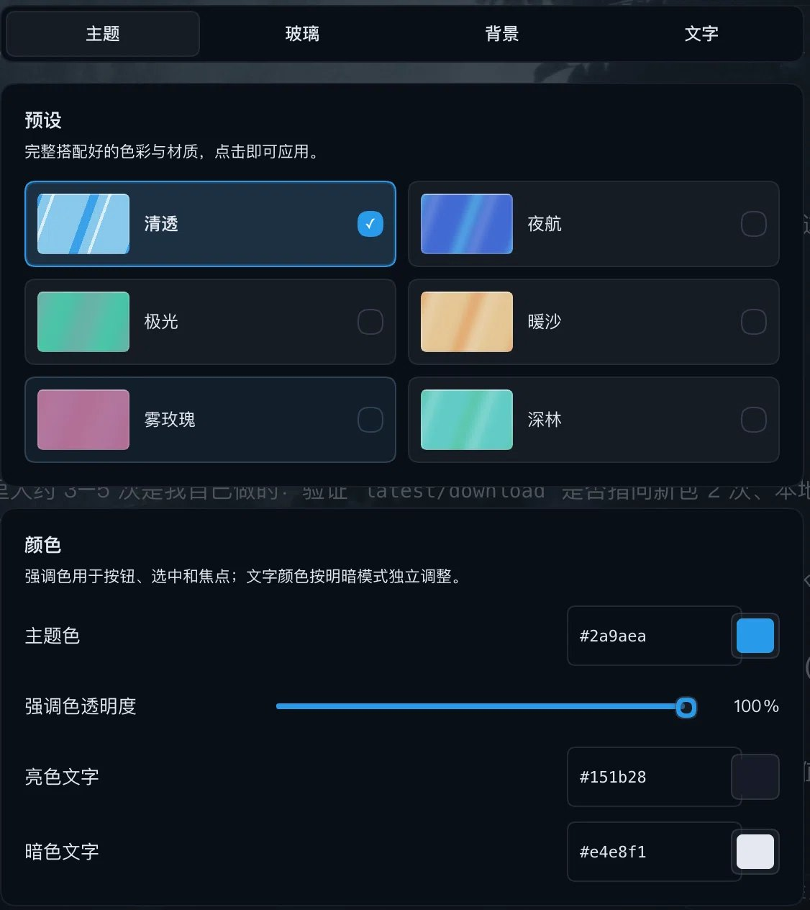
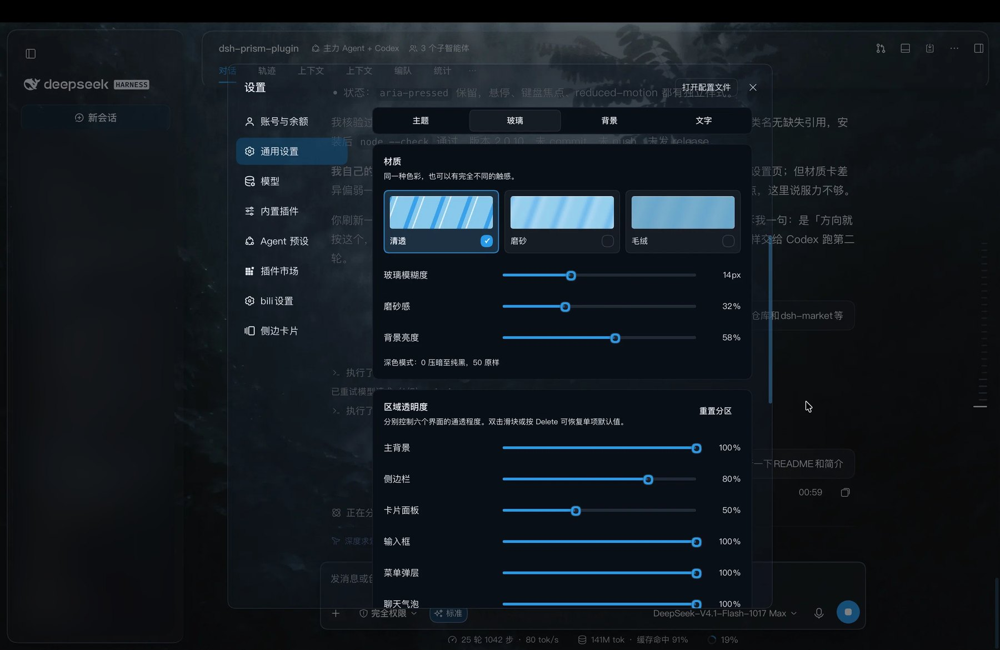
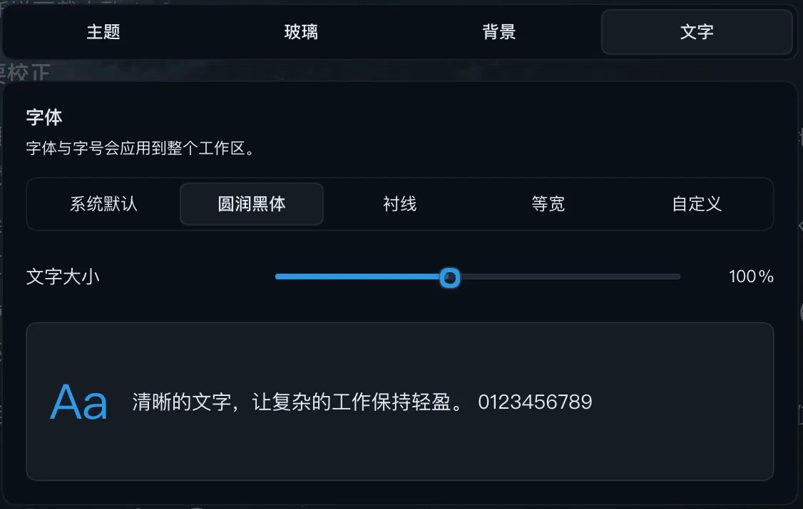

# DSH Background — Custom Background Images & Glassmorphism

**DSH Background** lets you upload your own photos or animated GIFs as the [DeepSeek Harness](https://github.com/deepseek-ai/deepseek-harness) Web GUI background, choose which of them join the carousel, reorder them by dragging, then tune glassmorphism, opacity, typography, colors, and motion. Version 2.0.10 is tested against DSH `0.2.2-rc.3`, retains compatibility with `0.2.2-rc.1+`, and ships prebuilt in `lib/`; installing the plugin does not require a build step.

## Screenshots

| Dark workspace · photo wallpaper | Dark workspace · water wallpaper |
|---|---|
|  |  |

| Light workspace · sky wallpaper | Background studio |
|---|---|
|  |  |

| Themes and presets | Materials and zone opacity |
|---|---|
|  |  |

| Typography |
|---|
|  |

## Features at a glance

| Feature | 功能 |
|---|---|
| Upload your own photos or GIFs, one or many at a time | 上传自己的照片或 GIF 动图，支持一次多选 |
| Separate light and dark playlists that follow the appearance mode | 亮色与暗色各一套背景列表，跟随明暗模式切换 |
| Per-image carousel selection: the corner badge decides which images rotate | 每张图独立参与轮播，右下角角标决定是否轮播 |
| Unselected images recede behind blur and frost, and sharpen when picked again | 未选中的图变模糊起雾，重新选中即恢复清晰 |
| Drag thumbnails to change the carousel order | 拖动缩略图即可调整轮播顺序 |
| Fixed or timed playback with an adjustable interval | 固定单张或定时轮播，间隔可调 |
| Clear, frosted, and velvet materials with separate blur and frost controls | 清透 / 磨砂 / 毛绒三档材质，模糊与磨砂强度分别可调 |
| Six independent zone opacities: base, sidebar, cards, inputs, overlays, bubbles | 六个区域独立透明度：主背景、侧边栏、卡片、输入框、弹层、气泡 |
| Accent, backdrop, and separate light/dark text colours | 强调色、底色，以及亮色 / 暗色文字各自独立 |
| Font family and scale applied to the whole workspace | 字体族与字号，作用于整个工作区 |
| Six presets plus portable custom themes exchanged as versioned JSON | 六套预设，外加可迁移的自定义主题（带版本号的 JSON） |
| Animated aurora, spring-damped transitions, and reduced-motion support | 流光极光、弹性过渡，并跟随系统「减弱动效」 |
| Master switch, `localStorage` persistence, and cross-tab sync | 总开关、`localStorage` 持久化、跨标签页同步 |

## Install

Requires DeepSeek Harness `0.2.2-rc.1` or later in the `0.2.x` series.

### Desktop app

Open **Settings → Plugins → Add plugin** and enter:

```text
github:mantonlove/dsh-prism-plugin
```

For local development, use `link:/absolute/path/to/dsh-prism-plugin` instead. Linked builds can be hot-applied; refresh the Web GUI if necessary.

### Web profile CLI

```sh
dsh plugin --profile web add github:mantonlove/dsh-prism-plugin
```

Restart `dsh web` and refresh the page. Open **设置 → 通用设置 → 外观 → DSH Background** to use the theme studio. The master switch is built into the DSH Background panel.

Uninstall:

```sh
dsh plugin --profile web remove dsh-client-ui-prism
```

## What’s new in v2

- **DSH 0.2.2-rc.3 compatibility:** supports the new sidebar-glass and card token family and opens the workspace columns to the backdrop, while retaining the rc.1/rc.2 token names.
- **Six visual presets:** Night, Aurora, Crystal, Dune, Rose, and Forest apply a complete, coordinated appearance recipe.
- **Portable custom themes:** save up to 24 named looks, apply or delete them, and exchange versioned JSON theme files. Import validates every value before applying it; duplicate names receive numeric suffixes instead of overwriting an existing look.
- **Task-oriented studio:** Themes, Glass, Backdrop, and Type tabs replace the old accordion and the retired `settings.plugin.item` master card.
- **Clearer controls:** accessible switches and buttons, selected/focus/disabled states, keyboard-operated sliders, double-click slider reset, and section-level zone reset.
- **Live miniature preview:** inspect the active palette and material before changing the main interface.
- **Reworked preset and material pickers:** presets are two-column rows whose colour chip carries the backdrop, accent, and a diagonal light trace; materials reuse the same trace in sharp, diffused, and softened treatments so clear, frosted, and velvet can be compared side by side before choosing.

## Theme features

- Clear, frosted, and velvet materials; blur and global frost; six independent zone opacities for the base, sidebar, cards, inputs, overlays, and bubbles.
- Hex and color-picker controls for the accent, backdrop, and light/dark text colors.
- **Custom background images:** upload several photos or animated GIFs at once into separate light/dark playlists; switch between fixed and automatic playback. The checkbox in each thumbnail's bottom-right corner decides whether that image joins the carousel (unchecked ones blur behind a frosted veil), and dragging the top-left grip changes the playback order.
- Spring-damped adjustments, font scale and family, and animated aurora.
- A master switch that restores the stock interface, persistent `localStorage` settings, cross-tab synchronization, and reduced-motion support.
- Theme exports contain appearance settings only. Wallpaper images, wallpaper playlists, and the master-switch state are never included.


## Development

Requires Node.js 22+ and pnpm 11.

```sh
pnpm install
pnpm typecheck
pnpm test
pnpm bundle
```

`pnpm bundle` builds the host modules, browser bundle, CSS modules, and declarations into `lib/`. The DSH client packages and React remain external and are supplied by the host Web GUI. Prebuilt release files are committed so source installs work without developer tooling.

[简体中文](README.zh.md) · [License](LICENSE)
