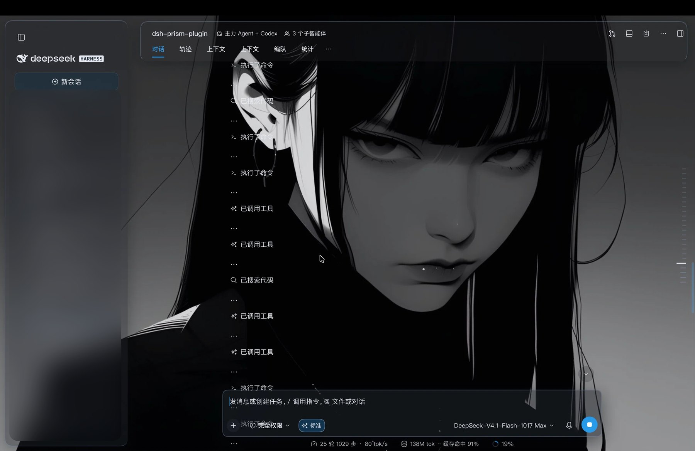
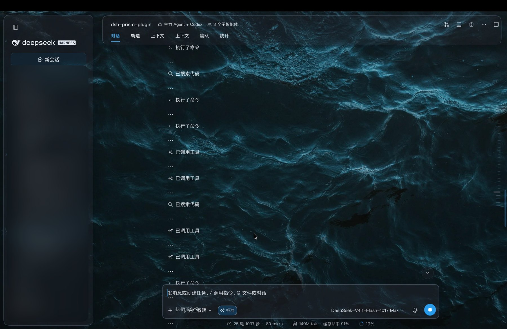
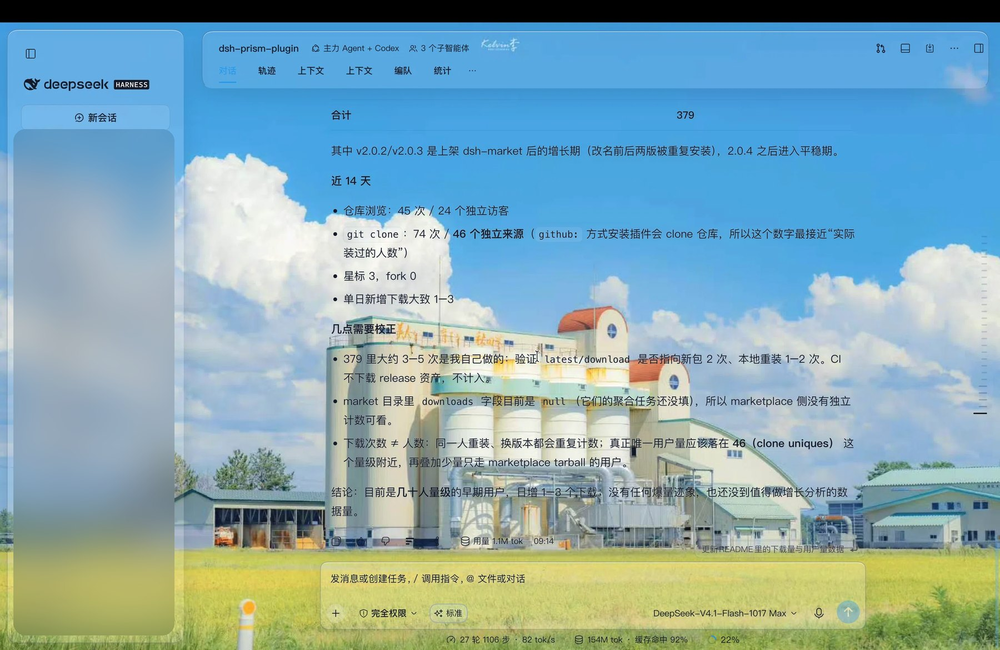
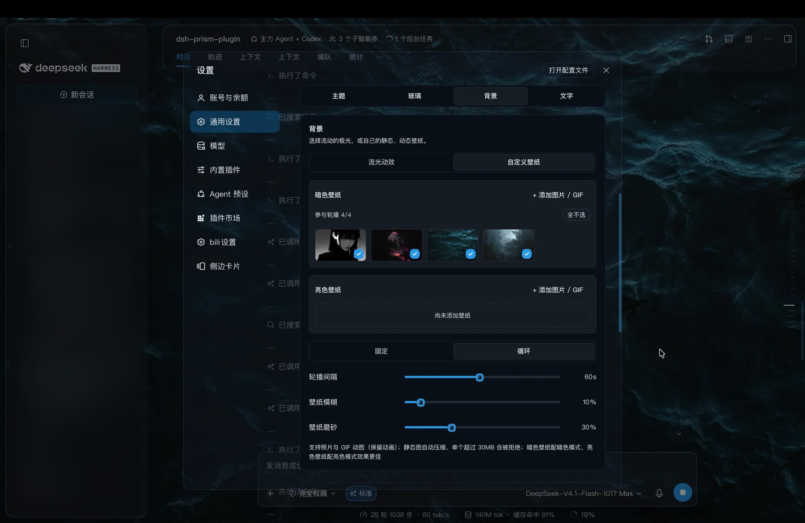
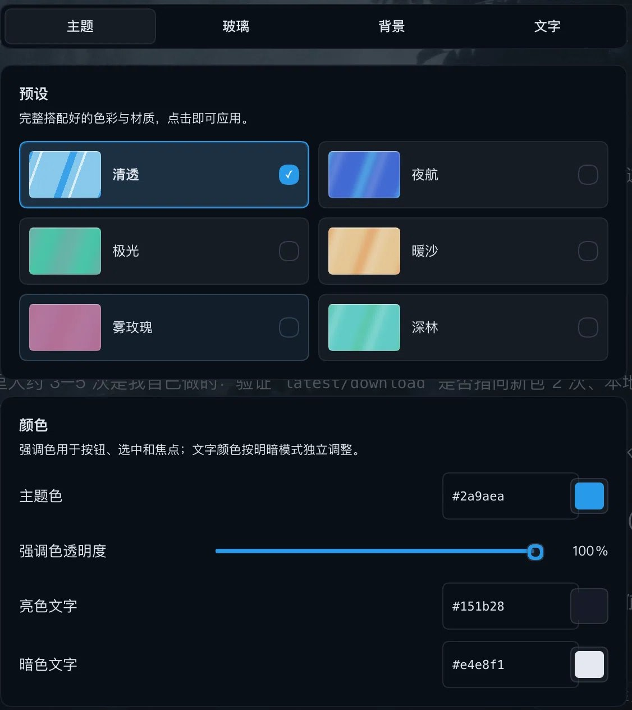
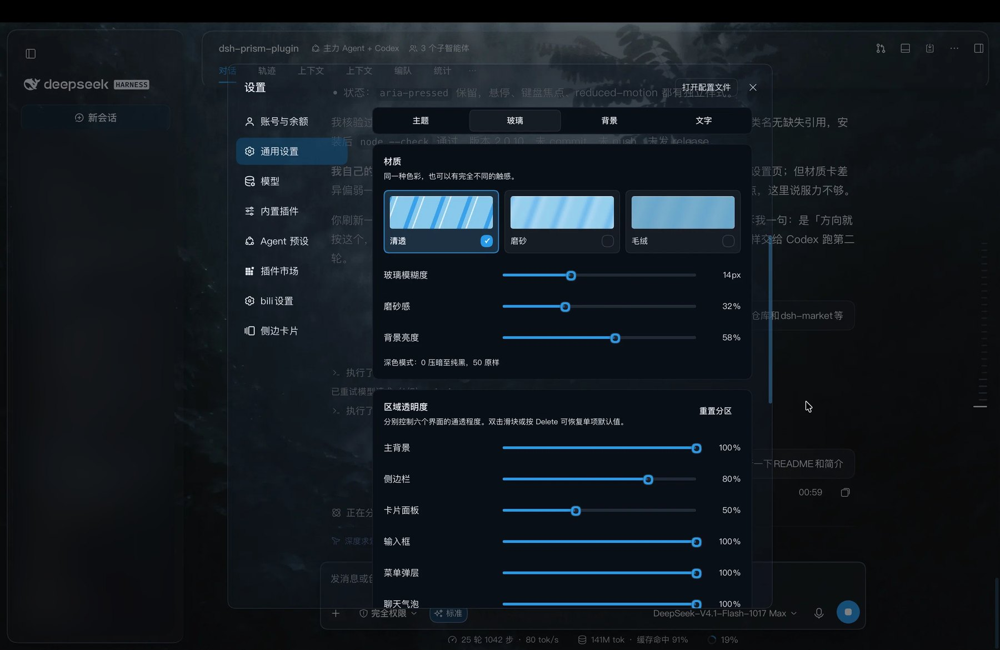
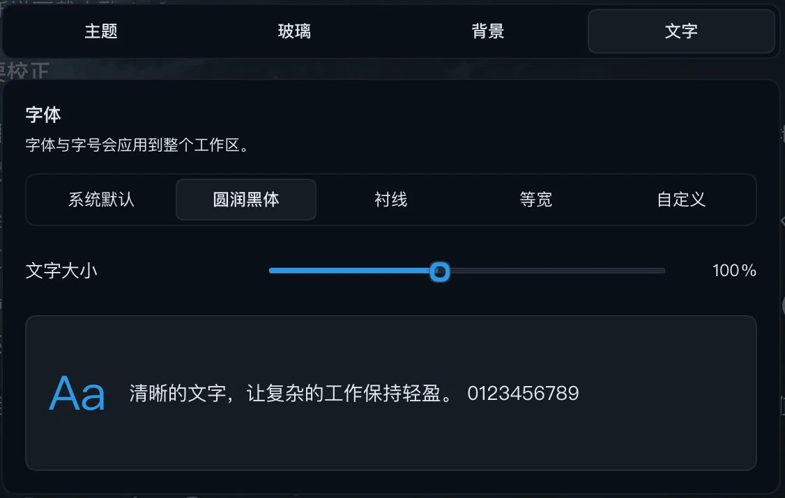

# DSH Background — 自定义背景图与毛玻璃主题

**DSH Background** 可以把你自己的照片或 GIF 动图上传为 [DeepSeek Harness](https://github.com/deepseek-ai/deepseek-harness) Web GUI 的背景，自己挑哪几张参与轮播、拖动调整顺序，并自由调整毛玻璃、透明度、字体、颜色与动效。v3.0.2 已在 DSH `0.2.2-rc.3` 上完成适配验证，同时保留对 `0.2.2-rc.1+` 的兼容性；npm 包名为 `dsh-prism-plugin`；仓库自带 `lib/` 预构建产物，安装插件无需执行构建。

## 效果展示

| 深色工作区 · 照片壁纸 | 深色工作区 · 水纹壁纸 |
|---|---|
|  |  |

| 亮色工作区 · 蓝天壁纸 | 背景设置 |
|---|---|
|  |  |

| 主题与预设 | 材质与区域透明度 |
|---|---|
|  |  |

| 文字 |
|---|
|  |

## 功能一览

| 功能 | Feature |
|---|---|
| 上传自己的照片或 GIF 动图，支持一次多选 | Upload your own photos or GIFs, one or many at a time |
| 照片、GIF 与 MP4/WebM 视频背景；视频存 IndexedDB，不占设置配额 | Photo, GIF, and MP4/WebM backdrops stored in IndexedDB so clips never eat the settings quota |
| 亮色与暗色各一套背景列表，跟随明暗模式切换 | Separate light and dark playlists that follow the appearance mode |
| 每张图独立参与轮播，右下角角标决定是否轮播 | Per-image carousel selection: the corner badge decides which images rotate |
| 未选中的图变模糊起雾，重新选中即恢复清晰 | Unselected images recede behind blur and frost, and sharpen when picked again |
| 拖动缩略图即可调整轮播顺序 | Drag thumbnails to change the carousel order |
| 固定单张或定时轮播，间隔可调 | Fixed or timed playback with an adjustable interval |
| 清透 / 磨砂 / 毛绒三档材质，模糊与磨砂强度分别可调 | Clear, frosted, and velvet materials with separate blur and frost controls |
| 六个区域独立透明度：主背景、侧边栏、卡片、输入框、弹层、气泡 | Six independent zone opacities: base, sidebar, cards, inputs, overlays, bubbles |
| 强调色、底色，以及亮色 / 暗色文字各自独立 | Accent, backdrop, and separate light/dark text colours |
| 字体族与字号，作用于整个工作区 | Font family and scale applied to the whole workspace |
| 六套预设，外加可迁移的自定义主题（带版本号的 JSON） | Six presets plus portable custom themes exchanged as versioned JSON |
| 流光极光、弹性过渡，并跟随系统「减弱动效」 | Animated aurora, spring-damped transitions, and reduced-motion support |
| 总开关、`localStorage` 持久化、跨标签页同步 | Master switch, `localStorage` persistence, and cross-tab sync |

## 安装

需要 DeepSeek Harness `0.2.2-rc.1` 或更高的 `0.2.x` 版本。

### 桌面 App

打开 **设置 → 插件 → 添加插件**，输入：

```text
github:mantonlove/dsh-prism-plugin
```

本地开发可改用 `link:/绝对路径/dsh-prism-plugin`。链接安装支持热更新；如未自动生效，刷新 Web GUI 即可。

### npm

```sh
dsh plugin --profile web add dsh-prism-plugin
```

包已发布到 npm，包名 `dsh-prism-plugin`。`@deepseek-ai/*` 这组 peer 依赖由 DSH 宿主提供，请用 DSH 的插件命令安装，不要在其他项目里直接 `npm install`。

也可以直接从仓库安装：

```sh
dsh plugin --profile web add github:mantonlove/dsh-prism-plugin
```

重启 `dsh web` 并刷新页面，然后打开 **设置 → 通用设置 → 外观 → DSH Background**。主题总开关已经并入 DSH Background 面板。

卸载：

```sh
dsh plugin --profile web remove dsh-prism-plugin
```

> **从 v2 升级？** v3 把包名改成了 `dsh-prism-plugin`。请先卸掉旧条目：两个包声明的都是同一个 `ui-prism` 层，同一时间只应保留其中一个：
>
> ```sh
> dsh plugin --profile web remove @deepseek-ai/dsh-client-ui-prism
> ```

## v3 新特性

- **npm 分发**：已发布到 npm，包名 `dsh-prism-plugin`，可直接按包名安装。插件市场是否显示下载量，取决于该平台自己的统计口径。
- **包名迁移**：旧的 `@deepseek-ai/dsh-client-ui-prism` 停用；`ui-prism` 层 id 与 `dsh.ui-prism.settings.v1` 存储键保持不变，原有主题、壁纸与偏好都会沿用。
- **区域不透明度修正**：卡片、输入框、弹层与气泡改为按滑块值直接合成，100% 即完全不透明；设置弹窗跟随“弹层”区域并保留最低可读底，文字不再压在壁纸上。

## v2 新特性

- **DSH 0.2.2-rc.3 适配**：支持新版侧栏毛玻璃与卡片令牌，并让工作区背景保持透明，同时保留 rc.1 / rc.2 的旧令牌兼容。
- **六套可视化预设**：夜色、极光、水晶、沙丘、玫瑰、森林，一键应用完整协调的外观方案。
- **可迁移自定义主题**：最多保存 24 套命名方案，可随时应用、删除，或通过带版本号的 JSON 文件导入导出；导入前会逐项校验，重名时自动添加数字后缀，不覆盖已有方案。
- **面向任务的工作台**：主题、玻璃、背景、字体四个标签页取代旧折叠面板，并迁移掉已被 DSH 删除的 `settings.plugin.item` 总开关卡片。
- **更清晰的控件**：无障碍开关与按钮、选中/焦点/禁用状态、键盘滑轨、双击滑轨复位，以及六区透明度一键重置。
- **实时微缩预览**：修改主界面前，先确认当前配色与材质效果。
- **重新设计的预设与材质面板**：预设改成两列条目，左侧色标同时呈现底色、强调色与斜向光纹；材质沿用同一束光纹，用清晰、扩散、柔化三档处理区分清透、磨砂、毛绒，便于并排比较后再选择。

## 主题功能

- 清透、磨砂、毛绒三种材质；模糊与全局磨砂感；主背景、侧边栏、卡片、输入框、菜单弹层、聊天气泡六区独立透明度。
- 主题色、背景色、明暗文字颜色均支持色号输入与取色器。
- **自定义背景（静态或动态）**：上传照片、GIF 动图或 MP4/WebM 视频（支持一次选多个），明暗模式分别管理列表；视频存 IndexedDB，静音循环播放，窗口失焦自动暂停；固定显示与自动轮播可切换。每张缩略图右下角的勾选框决定它是否参与轮播（未勾选的图片会变模糊、蒙上磨砂层），拖动缩略图左上角的手柄即可调整轮播先后顺序。
- 弹簧阻尼调节、文字大小与字体、动态极光。
- 总开关一键还原原生界面；设置通过 `localStorage` 持久化并跨标签页同步；支持减少动态效果。
- 主题导出只包含外观参数，不包含壁纸图片、壁纸播放列表或总开关状态。


## 开发

需要 Node.js 22+ 与 pnpm 11。

```sh
pnpm install
pnpm typecheck
pnpm test
pnpm bundle
```

`pnpm bundle` 会构建宿主模块、浏览器 bundle、CSS Modules 与类型声明到 `lib/`。DSH 客户端包与 React 保持 external，由宿主 Web GUI 提供。仓库提交预构建发行文件，因此从源码安装不依赖开发工具链。

[English](README.md) · [许可证](LICENSE)
