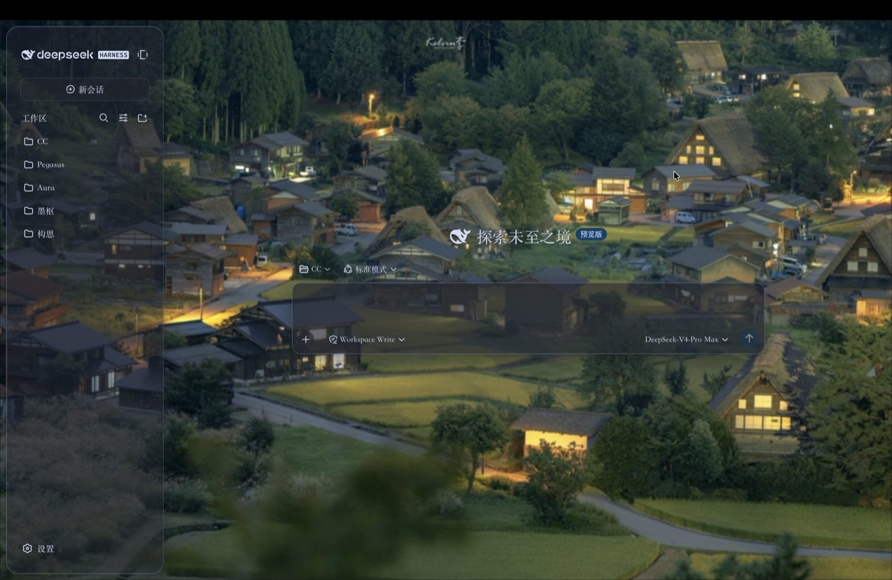
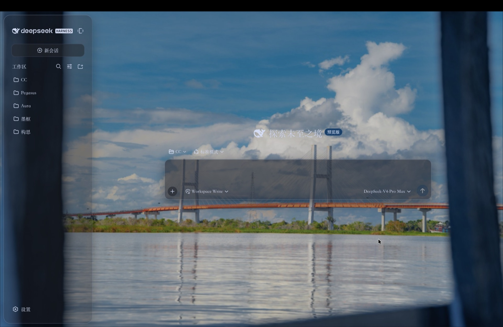
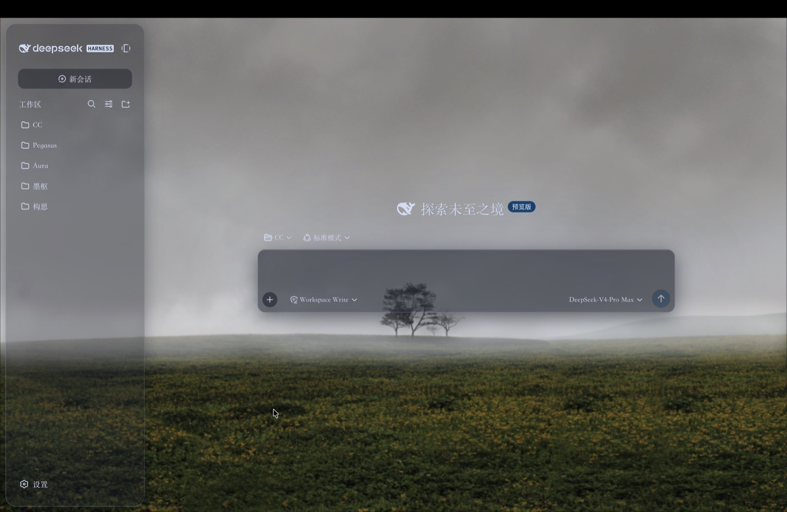

# DSH Background — 自定义背景图与毛玻璃主题

**DSH Background** 可以把你自己的照片或 GIF 动图上传为 [DeepSeek Harness](https://github.com/deepseek-ai/deepseek-harness) Web GUI 的背景，并自由调整毛玻璃、透明度、字体、颜色与动效。v2.0.3 已在 DSH `0.2.2-rc.3` 上完成适配验证，同时保留对 `0.2.2-rc.1+` 的兼容性；仓库自带 `lib/` 预构建产物，安装插件无需执行构建。

## 安装

需要 DeepSeek Harness `0.2.2-rc.1` 或更高的 `0.2.x` 版本。

### 桌面 App

打开 **设置 → 插件 → 添加插件**，输入：

```text
github:mantonlove/dsh-prism-plugin
```

本地开发可改用 `link:/绝对路径/dsh-prism-plugin`。链接安装支持热更新；如未自动生效，刷新 Web GUI 即可。

### Web profile 命令行

```sh
dsh plugin --profile web add github:mantonlove/dsh-prism-plugin
```

重启 `dsh web` 并刷新页面，然后打开 **设置 → 通用设置 → 外观 → DSH Background**。主题总开关已经并入 DSH Background 面板。

卸载：

```sh
dsh plugin --profile web remove dsh-client-ui-prism
```

## v2 新特性

- **DSH 0.2.2-rc.3 适配**：支持新版侧栏毛玻璃与卡片令牌，并让工作区背景保持透明，同时保留 rc.1 / rc.2 的旧令牌兼容。
- **六套可视化预设**：夜色、极光、水晶、沙丘、玫瑰、森林，一键应用完整协调的外观方案。
- **可迁移自定义主题**：最多保存 24 套命名方案，可随时应用、删除，或通过带版本号的 JSON 文件导入导出；导入前会逐项校验，重名时自动添加数字后缀，不覆盖已有方案。
- **面向任务的工作台**：主题、玻璃、背景、字体四个标签页取代旧折叠面板，并迁移掉已被 DSH 删除的 `settings.plugin.item` 总开关卡片。
- **更清晰的控件**：无障碍开关与按钮、选中/焦点/禁用状态、键盘滑轨、双击滑轨复位，以及六区透明度一键重置。
- **实时微缩预览**：修改主界面前，先确认当前配色与材质效果。

## 主题功能

- 清透、磨砂、毛绒三种材质；模糊与全局磨砂感；主背景、侧边栏、卡片、输入框、菜单弹层、聊天气泡六区独立透明度。
- 主题色、背景色、明暗文字颜色均支持色号输入与取色器。
- **自定义背景图**：上传自己的照片或 GIF 动图，明暗模式分别管理图片列表，支持固定显示、自动轮播与管理模式。
- 弹簧阻尼调节、文字大小与字体、动态极光。
- 总开关一键还原原生界面；设置通过 `localStorage` 持久化并跨标签页同步；支持减少动态效果。
- 主题导出只包含外观参数，不包含壁纸图片、壁纸播放列表或总开关状态。

## 效果展示

毛玻璃主题应用于工作区、欢迎页与输入框的效果示例：

| 效果一 | 效果二 | 效果三 |
|---|---|---|
|  |  |  |

## 开发

需要 Node.js 22+ 与 pnpm 11。

```sh
pnpm install
pnpm typecheck
pnpm test
pnpm bundle
```

`pnpm bundle` 会构建宿主模块、浏览器 bundle、CSS Modules 与类型声明到 `lib/`。DSH 客户端包与 React 保持 external，由宿主 Web GUI 提供。仓库提交预构建发行文件，因此从源码安装不依赖开发工具链。

[English](README.md) · [许可证](LICENSE)
